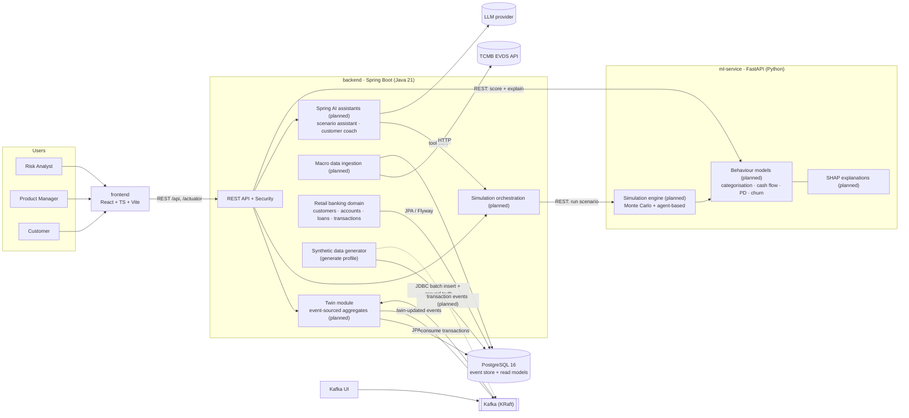

# FinTwin Architecture

> Status: domain model and synthetic data generator implemented; components marked *(planned)* do not exist in
> code yet. This document is the target design and is updated as features land.

## Service overview

## Responsibilities

| Component | Responsibility |
|-----------|----------------|
| **frontend** | UI for the three roles; talks only to the backend (dev server proxies `/api` and `/actuator`). |
| **backend** | System of record. Owns the retail banking domain (customers, accounts, cards, loans, transactions, events), authentication/authorisation, customer twins (event-sourced from Kafka), macro data, scenario orchestration and the Spring AI assistants. Also hosts the deterministic synthetic data generator ([data-generation.md](data-generation.md)). |
| **ml-service** | Stateless compute: model inference, SHAP explanations, simulation runs. Trains on the public schema and validates against `ground_truth.*`. |
| **PostgreSQL** | Domain tables, event store, twin read models, macro time series, simulation results, and the `ground_truth` schema written by the generator. Schema owned by backend Flyway migrations. |
| **Kafka** | Transport for transaction events and twin change events. |

## Key flows (target)

0. **Data generation** — the `generate` profile simulates the portfolio day by day and bulk-loads it, together with
   hidden states and labels in `ground_truth.*`.
1. **Twin update** — generator publishes `TransactionRecorded` → backend consumes, appends to event store, updates the
   twin projection, emits `TwinUpdated`.
2. **Scenario run** — analyst (directly or via the scenario assistant) defines macro shocks (FX, rate, inflation) →
   backend loads twin snapshots + EVDS baseline → ml-service simulation engine runs Monte Carlo paths →
   portfolio-level results (PD distribution, expected loss, churn) are stored and returned.
3. **Customer coaching** — customer asks the coach about a goal → assistant calls cash-flow forecast / simulation tools
   for that single twin → answer includes SHAP-based explanation.

## Decisions

- Synthetic data generator lives in the backend (not the ml-service): it writes the backend-owned schema in bulk and
  will later replay transactions to Kafka. See [data-generation.md](data-generation.md).

## Open decisions

- Simulation engine placement: proposed in ml-service (NumPy, close to the models); revisit if latency or
  orchestration needs push it into the backend.
- LLM provider for Spring AI.
- Kafka topic schema format (JSON vs. Avro/Schema Registry).
