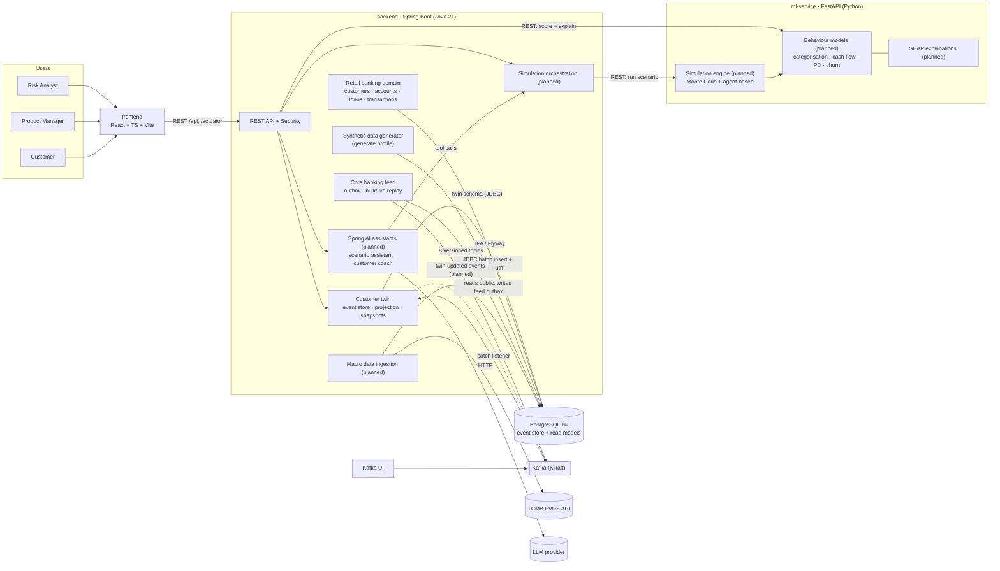
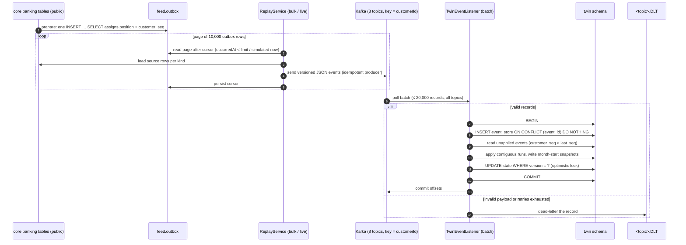

# FinTwin Architecture

> Status: domain model, synthetic data generator, core banking feed and event-sourced twin implemented; components
> marked *(planned)* do not exist in
> code yet. This document is the target design and is updated as features land.

## Service overview

## Responsibilities

| Component | Responsibility |
|-----------|----------------|
| **frontend** | UI for the three roles; talks only to the backend (dev server proxies `/api` and `/actuator`). |
| **backend** | System of record. Owns the retail banking domain (customers, accounts, cards, loans, transactions, events), authentication/authorisation, customer twins (event-sourced from Kafka), macro data, scenario orchestration and the Spring AI assistants. Also hosts the deterministic synthetic data generator ([data-generation.md](data-generation.md)). |
| **ml-service** | Stateless compute: model inference, SHAP explanations, simulation runs. Trains on the public schema and validates against `ground_truth.*`. |
| **PostgreSQL** | Domain tables, event store, twin read models, macro time series, simulation results, and the `ground_truth` schema written by the generator. Schema owned by backend Flyway migrations. |
| **Kafka** | Transport of core banking events to the twin (8 topics + dead letter topics); later twin change events. |

## Key flows (target)

0. **Data generation** — the `generate` profile simulates the portfolio day by day and bulk-loads it, together with
   hidden states and labels in `ground_truth.*`.
1. **Twin update** — the core banking feed replays the outbox to Kafka → the twin appends each event to its event
   store and advances the customer's projection in sequence order (see the event flow below and
   [twin.md](twin.md)). Emitting `TwinUpdated` is planned.
2. **Scenario run** — analyst (directly or via the scenario assistant) defines macro shocks (FX, rate, inflation) →
   backend loads twin snapshots + EVDS baseline → ml-service simulation engine runs Monte Carlo paths →
   portfolio-level results (PD distribution, expected loss, churn) are stored and returned.
3. **Customer coaching** — customer asks the coach about a goal → assistant calls cash-flow forecast / simulation tools
   for that single twin → answer includes SHAP-based explanation.

## Event flow: core banking → twin

## Decisions

- Synthetic data generator lives in the backend (not the ml-service): it writes the backend-owned schema in bulk and
  will later replay transactions to Kafka. See [data-generation.md](data-generation.md).
- Kafka payloads are JSON with versioned Java records (`...V1`, `schemaVersion` in every event; incompatible
  changes get a new record and `.v2` topic). No schema registry for now — revisit if non-JVM producers appear.
- The core banking feed publishes from a transactional-outbox table: ordering (global position, per-customer
  sequence) is fixed once in SQL, replays are resumable and republishing is idempotent. See [twin.md](twin.md).
- The twin applies events by per-customer sequence, not by arrival, because Kafka orders only within one
  partition of one topic; the event store is also the re-sequencing buffer.
- The twin reads neither the core banking tables nor `ground_truth` (enforced by `TwinIsolationTests`).

## Open decisions

- Simulation engine placement: proposed in ml-service (NumPy, close to the models); revisit if latency or
  orchestration needs push it into the backend.
- LLM provider for Spring AI.
