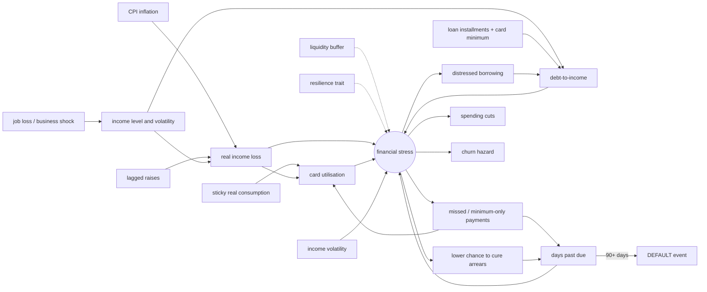

# Synthetic data generation

FinTwin's customer, account and transaction data comes from a deterministic, causally structured synthetic
generator (`com.fintwin.generator` in the backend). This document explains how to run it, the design decisions
behind it, and — in the auto-generated section at the end — what the current data set looks like.

## Running it

```bash
make up                                   # PostgreSQL must be running
make generate                             # = cd backend && ./mvnw spring-boot:run -Dspring-boot.run.profiles=local,generate
```

The `generate` profile starts the application without a web server, truncates previously generated data, generates,
updates the report section of this file and exits. Settings (`application-generate.yml`, overridable via
environment variables):

| Property | Env var | Default | Meaning |
|---|---|---|---|
| `fintwin.generator.customer-count` | `GENERATOR_CUSTOMERS` | 5000 | customers |
| `fintwin.generator.months` | `GENERATOR_MONTHS` | 24 | months of history |
| `fintwin.generator.seed` | `GENERATOR_SEED` | 42 | master seed |
| `fintwin.generator.end-month` | `GENERATOR_END_MONTH` | 2026-09 | last simulated month |
| `fintwin.generator.reset` | `GENERATOR_RESET` | true | truncate generated tables first |
| `fintwin.generator.report-path` | `GENERATOR_REPORT_PATH` | `../docs/data-generation.md` | report target |
| `chunk-size`, `batch-size`, `parallelism`, `write-threads` | – | 250, 5000, #CPUs, 4 | performance tuning |

Reference data (`merchant_category`, `macro_indicator`) is owned by Flyway and never touched by the generator.

## Data model

| Table | Content |
|---|---|
| `customer` | age, city, occupation group, segment (`STUDENT`, `MIN_WAGE`, `WHITE_COLLAR`, `RETIREE`, `SELF_EMPLOYED`), latest monthly net income, customer-since date, status |
| `account` | `CHECKING` (TRY or USD), `TIME_DEPOSIT` (rate, maturity), `CREDIT_CARD` (limit, statement day, due day); balance = funds, or outstanding debt for cards |
| `card_statement` | monthly statement: balance, minimum payment, amount paid, days past due |
| `loan`, `loan_installment` | `PERSONAL` / `MORTGAGE` with principal, monthly rate, term and the full annuity repayment plan |
| `merchant_category`, `merchant` | 20 categories (also the label set of the categorisation model) and ~1,200 fictional merchants |
| `bank_transaction` | amount (> 0) + direction, channel (`POS`, `ECOMMERCE`, `ATM`, `EFT_FAST`, `AUTO_PAYMENT`), installment count, raw description |
| `customer_event` | labelled outcomes: `LATE_PAYMENT`, `DEFAULT` (90+ DPD), `CHURN` |
| `macro_indicator` | monthly CPI inflation, policy rate, USD/TRY (seed now, TCMB EVDS later) |
| `ground_truth.*` | hidden variables and labels — see below |

Decisions:

- **`bank_transaction`, not `transaction`** (SQL keyword). `customer_id` is denormalised onto it so per-customer
  time-range queries use `idx_bank_transaction_customer_time` without a join.
- **Money is `NUMERIC(19,2)` / `BigDecimal`**; amounts are always positive and the sign lives in `direction`.
  Inside the simulation money is held as `long` minor units (exact integer arithmetic, no `double` balances) and
  converted to `BigDecimal` when written. Random draws are doubles, rounded to kuruş when they become an amount.
- **Loan rates are monthly** (`monthly_interest_rate`), the way Turkish retail loans are quoted.
- **`card_statement` was added** beyond the requested entities: minimum-payment behaviour and days past due cannot
  be expressed without statements.
- **Ground truth is a separate schema.** `ground_truth.customer_latent` (static traits),
  `ground_truth.customer_monthly_state` (month-end hidden stress and its drivers, event probabilities, DPD),
  `ground_truth.customer_outcome` (per-customer labels), `ground_truth.transaction_label` (true category of each
  transaction) and `ground_truth.generation_run` (parameters of the run). Models must be trained on the public
  schema only; a separate schema makes label leakage visible in every query.
- Ids are `GENERATED BY DEFAULT AS IDENTITY`: the generator writes explicit, deterministic ids and moves the
  sequences past them afterwards, so normal inserts keep working.

## Design of the generator

### Why in the backend

The backend owns the schema and is the system of record; generating there reuses the Flyway schema directly and
keeps the bulk loader next to it. The generator is pure Java (no Spring in `simulation/`), so it can later also
emit transactions to Kafka (`fintwin.transactions.recorded.v1`) for the event-sourced twin.

### Determinism

- Each customer has its own random stream derived from `(seed, customer index)` with a SplitMix64 mix and
  `SplittableRandom` (fully specified algorithm). Gaussian, lognormal and Poisson sampling are implemented in
  `Rand` rather than taken from the JDK, so output is stable across JDK versions.
- A customer's history therefore does not depend on how many customers are generated, on chunking, or on thread
  scheduling. The merchant catalog has its own stream.
- The horizon ends at a configured month (`end-month`, default 2026-09), never "now".
- Database ids are assigned sequentially in customer order before chunks are written concurrently.
- Verified by unit tests (same seed → same SHA-256 fingerprint; parallel = sequential; one customer simulated alone =
  same customer inside a portfolio), an integration test (same seed → same table checksum after a reset) and on the
  full data set: two consecutive 5,000 × 24 runs produced identical checksums over all 5.48 M transactions and all
  monthly hidden states.

### Simulation

Every customer is simulated day by day over the horizon (`CustomerSimulator`):

- **Segments** (`SegmentProfile`) set income distribution, age range, occupations, product take-up (card, loans,
  deposit, USD account), renting, car ownership, consumption ratio, card usage, repayment style mix, job-loss hazard
  and churn offset. Profile money is expressed at October 2024 prices and indexed with the macro path.
- **Income and pay-day pattern.** Minimum-wage earners follow the official net minimum wage (17,002 → 22,104 →
  28,075 TRY, raised each January); white-collar salaries are raised in January (and for some in July) by a
  customer-specific 50–100 % share of past inflation; pensions are indexed every January/July to the previous six
  months of inflation, plus the SGK holiday bonus before each bayram; self-employed income follows prices with a
  2–3 month lag, seasonality and high volatility, arriving as several incoming transfers; students receive family
  allowance or part-time pay plus, for some, the KYK scholarship (October–June). Salaries are paid on the
  customer's pay day, moved to the previous business day around weekends and holidays. Occasional bonuses,
  severance pay and unemployment benefit (İŞKUR) appear around job loss.
- **Real-income erosion.** Prices rise every month with CPI, incomes only at their raise dates, so real income
  erodes between raises (the sawtooth in *Avg real income loss* in the report). Consumption is habit-based in
  real terms and only partially adjusts to current real income, so eroding real income shows up as higher card
  utilisation and debt service rather than as instantly lower spending.
- **Regular costs.** Rent (raised yearly on the contract anniversary by 12-month CPI), electricity, natural gas
  (strong heating seasonality), water, mobile/internet/TV and digital subscriptions, paid by direct debit from the
  account or the card.
- **Discretionary spending** in 11 categories: Poisson counts and lognormal tickets from a real budget, with
  weekend multipliers, a pay-day cycle (more spending in the five days after pay day, less before the next one),
  pre-bayram shopping, bayram travel, Black Friday, New Year, summer travel and school-start effects; FX-sensitive
  categories (electronics, travel) also track USD/TRY. Customers have favourite local merchants (Zipf) and an
  online share per category. Larger card purchases are split into 2–12 installments, more often under stress.
- **Credit cards.** Limits from income (raised with inflation if the card is in good standing), monthly
  statements with interest tied to the policy rate, the minimum payment rule (20 % of the balance, 40 % for limits
  ≥ 50,000 TRY, plus anything past due), and repayment behaviour by latent payer type (transactor / revolver /
  minimum payer). Cards are blocked for purchases while delinquent; stressed customers with no cash take card cash
  advances.
- **Loans.** Existing loans at the start of the horizon (with their past installments paid) and new ones during it:
  personal loans with the BDDK maturity caps (≤ 36 months up to 50k TRY, 24 up to 100k, 12 above), sized so the
  installment stays below 35 % of income and approved only below 50 % DTI; a distressed-borrowing channel (stress ×
  low liquidity raises the hazard); mortgages for renters with savings. Installments are auto-debited.
- **Savings.** Surplus moves to a time deposit (interest = policy rate − 4 pp, net of withholding, capitalised) and
  sometimes into USD; deposits are broken when the checking account cannot cover an essential payment.

### Causal mechanism



Each month-end (`StressModel`):

```
x_t      = -2.4 + 2.0·min(DTI, 2) + 3.0·clip(realIncomeLoss, -0.3, 0.8) + 1.8·min(utilisation, 1.2)
           + 1.5·min(incomeVolatility, 1.5) - 0.6·resilience - 0.5·ln(1 + bufferMonths) + 0.8·min(DPD/30, 3) + ε
stress_t = 0.6·stress_{t-1} + 0.4·sigmoid(x_t),        ε ~ N(0, 0.25)
```

Events are generated from stress, never sampled directly:

- **Late payment.** At a due date a current customer misses with `p_miss = sigmoid(-7.5 + 7·stress)` (behavioural)
  or because there is not enough money even after breaking the deposit (liquidity). Loans are auto-debited, so
  their behavioural miss rate is 40 % of the card's. The first miss of an episode is a `LATE_PAYMENT` event.
- **Cure.** A delinquent customer tries to clear arrears on pay days and due dates with
  `p_cure = sigmoid(4.0 - 6.5·stress)`; days past due accumulate on statements and installments until then.
- **Default.** When the oldest unpaid card minimum or installment reaches 90 days past due a `DEFAULT` event is
  written, the customer's loans become `DEFAULTED`, the card is closed and activity stops.
- **Churn.** Customers without loans or arrears decide to leave with
  `p_churn = sigmoid(-6.1 + 4·stress + churnPropensity + segment offset + 0.6·[tenure < 12 months])`. The decision
  leads the event by 1–3 months during which activity declines (85 % → 65 % → 40 % → 20 %); on the churn date
  the card is paid off, balances are transferred out, all accounts are closed and a `CHURN` event is written.

All hidden variables (stress, drivers, `p_miss`, `p_churn`, DPD, unemployment, churn intent) are stored monthly in
`ground_truth.customer_monthly_state`.

### Noisy descriptions

`DescriptionNoiser` builds statement text the way acquirers and core banking systems print it: upper-case ASCII
with Turkish letters folded, random abbreviations (`MARKET` → `MKT`/`MRKT`, `ECZANESI` → `ECZ`, `TICARET` → `TIC`),
terminal and branch numbers (`SB.852`), district and city codes (`KADIKOY IST`), gateway prefixes (`IYZICO*`,
`PAYTR *`, `SANAL POS`), web forms (`PAZARYERI.COM.TR`), installment markers (`6 TAKSIT`, `TKS:6`, `(6 TKS)`),
occasional typos and truncation to 40 characters for POS lines. Each merchant terminal has a stable descriptor,
so the same shop recurs with small variations — as on real statements. Merchant, employer and person names are
fictional. The true category is stored only in `ground_truth.transaction_label`.

### Performance

- Simulation runs in parallel chunks of 250 customers (5.5 s CPU in total for 5,000 × 24 months).
- Writes use `JdbcTemplate.batchUpdate` (batches of 5,000) with the driver's `reWriteBatchedInserts`,
  `synchronous_commit = off` for the session, one transaction per chunk, and 4 concurrent writer connections fed
  through a bounded pipeline while the next chunk is simulated. Ids are pre-assigned, so parallel writes stay
  deterministic.
- Effect: a single writer reached ~26k rows/s; the pipelined version ~85k rows/s, i.e. 11.2 M rows in ~2.2
  minutes on a laptop running PostgreSQL in Docker Desktop. Progress and per-phase timings are logged.

### Calibration

Parameters were tuned on 1,000–2,000 customer runs and then confirmed on the full data set:

| Iteration | Change | Default | Churn | ≥1 late |
|---|---|---|---|---|
| 1 | initial parameters | 0.7 % | 6.2 % | 26.5 % |
| 2 | stress-dependent cure probability, more job-loss risk | 10.5 % | 6.6 % | 25.4 % |
| 3 | easier cure (intercept 3.5), lower miss rate, lower student/min-wage consumption | 5.3 % | 7.7 % | 22.2 % |
| 4 | cure intercept 4.0, churn intercept −5.6 | 4.5 % | 9.2 % | 22.2 % |
| 5 (final) | churn stress slope 2 → 4 (intercept −6.1) so that churn visibly rises with stress | 4.1 % | 8.2 % | 22.7 % |

Targets were a 2–5 % cumulative 24-month default rate (Turkish retail NPL ratios are ~2–4 % of balances; a
stressed 2025 macro and a customer-count basis justify the upper half), 8–15 % churn over two years and 10–25 % of
customers with at least one late payment. In the final data set default rises monotonically from ~0.2 % in the
lowest stress decile to ~13 % in the highest, and churn roughly triples from the lowest to the highest deciles.

### Known simplifications

- Macro values are a seed approximating published TCMB/TÜİK figures; months after the latest publication are
  plausible projections. The EVDS integration will replace them.
- No overdraft accounts (KMH), no card cash-advance fees, no KKDF/BSMV taxes on loan interest, no partial
  installment payments, a single TRY card per customer.
- Collections after default and re-activation after churn are not modelled; such customers simply stop.
- Customers do not interact (no households); macro shocks affect all customers through prices, raises and rates
  only, not through an explicit unemployment-rate series.

## Generation report

<!-- generation-report:start -->
_Generated by the `generate` profile; do not edit this section by hand._

### Run

| Parameter | Value |
|---|---|
| Customers | 5,000 |
| Months | 24 (2024-10 .. 2026-09) |
| Seed | 42 |
| Total rows | 11,229,518 |
| Wall-clock time | 132.2 s |
| Simulation time (parallel, overlapped) | 5.5 s |
| Database write time (summed over writer threads) | 509.4 s |
| Throughput | 84,971 rows/s |

### Row counts

| Table | Rows |
|---|---|
| `merchant` | 1,164 |
| `customer` | 5,000 |
| `account` | 11,232 |
| `card_statement` | 71,183 |
| `loan` | 2,166 |
| `loan_installment` | 56,976 |
| `bank_transaction` | 5,481,647 |
| `customer_event` | 4,649 |
| `ground_truth.transaction_label` | 5,481,647 |
| `ground_truth.customer_latent` | 5,000 |
| `ground_truth.customer_monthly_state` | 103,854 |
| `ground_truth.customer_outcome` | 5,000 |

### Outcome rates

| Metric | Value |
|---|---|
| Customers | 5,000 |
| Customers with credit exposure (card or loan) | 3,820 |
| Default rate (DEFAULT = 90+ DPD), all customers | 4.06% |
| Default rate, customers with credit exposure | 5.31% |
| Churn rate | 8.22% |
| Customers with at least one late payment | 22.68% |
| Customers with an unemployment / income shock spell | 6.06% |
| `CHURN` events | 411 |
| `DEFAULT` events | 203 |
| `LATE_PAYMENT` events | 4,035 |

### Segments

| Segment | Customers | Share | Median base income | Median latest income | Base income range | Has card | Has loan | Mean stress | ≥1 late | Default | Churn |
|---|---|---|---|---|---|---|---|---|---|---|---|
| WHITE_COLLAR | 1,611 | 32.22% | 52,269 | 88,743 | 28,000 – 198,297 | 87.71% | 45.38% | 0.159 | 13.16% | 1.18% | 6.58% |
| MIN_WAGE | 1,406 | 28.12% | 20,283 | 33,013 | 17,010 – 23,790 | 59.89% | 39.33% | 0.219 | 28.95% | 6.69% | 8.18% |
| RETIREE | 755 | 15.10% | 19,241 | 33,017 | 12,500 – 45,000 | 54.97% | 29.93% | 0.127 | 16.69% | 1.06% | 3.58% |
| STUDENT | 615 | 12.30% | 7,568 | 9,643 | 3,500 – 16,000 | 33.50% | 12.52% | 0.207 | 22.93% | 5.85% | 14.15% |
| SELF_EMPLOYED | 613 | 12.26% | 51,166 | 72,273 | 15,000 – 389,719 | 79.61% | 39.64% | 0.317 | 40.46% | 7.50% | 12.40% |

### Default and churn by financial stress decile

Stress measured at the end of 2025-03 for customers that were current (0 DPD) at that point; outcomes are events after the snapshot until the end of the horizon.

| Stress decile | Customers | Stress range | Later late payment | Later default | Later churn |
|---|---|---|---|---|---|
| 1 | 418 | 0.010 – 0.043 | 3.83% | 0.24% | 5.50% |
| 2 | 418 | 0.043 – 0.060 | 3.35% | 0.00% | 2.63% |
| 3 | 418 | 0.060 – 0.078 | 8.61% | 0.72% | 5.74% |
| 4 | 418 | 0.078 – 0.099 | 7.66% | 0.48% | 7.18% |
| 5 | 418 | 0.099 – 0.125 | 11.24% | 0.96% | 6.22% |
| 6 | 418 | 0.125 – 0.161 | 16.03% | 1.44% | 7.89% |
| 7 | 417 | 0.161 – 0.207 | 16.31% | 1.68% | 6.00% |
| 8 | 417 | 0.207 – 0.276 | 21.58% | 3.60% | 6.95% |
| 9 | 417 | 0.276 – 0.397 | 30.70% | 5.04% | 13.43% |
| 10 | 417 | 0.398 – 0.884 | 48.68% | 13.43% | 14.87% |

### Monthly transaction volume and hidden state

| Month | Transactions | Active customers | Tx / customer | Card+debit purchases (TRY) | CPI m/m | Avg income | Avg real income loss | Avg stress | Avg card utilisation | 30+ DPD share |
|---|---|---|---|---|---|---|---|---|---|---|
| 2024-10 | 218,465 | 4,219 | 51.8 | 93 M | 2.88% | 36,686 | -0.39% | 0.168 | 23.35% | 0.00% |
| 2024-11 | 226,151 | 4,249 | 53.2 | 99 M | 2.24% | 36,229 | 2.28% | 0.182 | 26.39% | 0.47% |
| 2024-12 | 227,970 | 4,281 | 53.3 | 100 M | 1.03% | 41,417 | 0.81% | 0.187 | 27.66% | 0.80% |
| 2025-01 | 220,832 | 4,307 | 51.3 | 98 M | 5.03% | 44,199 | -0.47% | 0.191 | 27.29% | 0.91% |
| 2025-02 | 220,188 | 4,307 | 51.1 | 101 M | 2.27% | 44,144 | -4.12% | 0.191 | 28.92% | 0.63% |
| 2025-03 | 231,545 | 4,325 | 53.5 | 114 M | 2.46% | 51,185 | -9.11% | 0.184 | 29.14% | 0.51% |
| 2025-04 | 221,821 | 4,340 | 51.1 | 108 M | 3.00% | 45,669 | -6.43% | 0.184 | 29.56% | 0.58% |
| 2025-05 | 226,637 | 4,345 | 52.2 | 114 M | 1.53% | 45,577 | -5.58% | 0.181 | 29.37% | 0.46% |
| 2025-06 | 237,431 | 4,350 | 54.6 | 129 M | 1.37% | 46,418 | -2.24% | 0.181 | 31.25% | 0.49% |
| 2025-07 | 230,867 | 4,353 | 53.0 | 129 M | 2.06% | 47,239 | -1.08% | 0.184 | 30.45% | 0.53% |
| 2025-08 | 229,350 | 4,352 | 52.7 | 133 M | 2.04% | 47,159 | 0.14% | 0.189 | 31.43% | 0.62% |
| 2025-09 | 225,237 | 4,356 | 51.7 | 131 M | 3.23% | 47,638 | 3.14% | 0.196 | 32.21% | 0.76% |
| 2025-10 | 224,308 | 4,360 | 51.4 | 124 M | 2.55% | 47,658 | 4.44% | 0.200 | 31.09% | 0.88% |
| 2025-11 | 230,796 | 4,370 | 52.8 | 130 M | 0.87% | 48,117 | 3.87% | 0.201 | 31.98% | 1.06% |
| 2025-12 | 229,448 | 4,384 | 52.3 | 129 M | 0.89% | 54,128 | 1.25% | 0.196 | 31.56% | 0.76% |
| 2026-01 | 225,741 | 4,386 | 51.5 | 130 M | 4.50% | 56,148 | 0.16% | 0.193 | 30.22% | 0.78% |
| 2026-02 | 224,180 | 4,378 | 51.2 | 132 M | 2.10% | 55,954 | -2.95% | 0.190 | 31.25% | 0.62% |
| 2026-03 | 234,799 | 4,389 | 53.5 | 149 M | 2.00% | 63,501 | -6.84% | 0.181 | 30.77% | 0.64% |
| 2026-04 | 225,391 | 4,390 | 51.3 | 141 M | 2.40% | 57,883 | -4.99% | 0.178 | 30.97% | 0.50% |
| 2026-05 | 237,283 | 4,393 | 54.0 | 160 M | 1.40% | 59,191 | -5.03% | 0.174 | 31.58% | 0.46% |
| 2026-06 | 232,821 | 4,390 | 53.0 | 152 M | 1.20% | 58,485 | -1.52% | 0.173 | 31.96% | 0.57% |
| 2026-07 | 235,714 | 4,407 | 53.5 | 168 M | 1.90% | 59,958 | -0.41% | 0.174 | 31.42% | 0.64% |
| 2026-08 | 235,156 | 4,413 | 53.3 | 169 M | 1.60% | 59,754 | 1.26% | 0.178 | 31.97% | 0.68% |
| 2026-09 | 229,516 | 4,414 | 52.0 | 169 M | 2.30% | 60,531 | 2.61% | 0.184 | 32.85% | 0.73% |

### Category distribution (ground-truth labels)

| Category | Transactions | Share | Volume (TRY) | Avg amount (TRY) |
|---|---|---|---|---|
| `GROCERY` | 1,317,080 | 24.03% | 905 M | 687 |
| `RESTAURANT` | 877,685 | 16.01% | 441 M | 503 |
| `TRANSPORT` | 721,510 | 13.16% | 93 M | 129 |
| `ENTERTAINMENT` | 347,122 | 6.33% | 157 M | 452 |
| `ECOMMERCE` | 340,470 | 6.21% | 340 M | 999 |
| `UTILITIES` | 283,975 | 5.18% | 269 M | 946 |
| `TRANSFER` | 277,801 | 5.07% | 2,371 M | 8,536 |
| `TELECOM` | 197,357 | 3.60% | 113 M | 574 |
| `CLOTHING` | 189,759 | 3.46% | 286 M | 1,505 |
| `CASH_WITHDRAWAL` | 184,987 | 3.37% | 180 M | 975 |
| `FUEL` | 167,152 | 3.05% | 149 M | 893 |
| `CARD_PAYMENT` | 144,930 | 2.64% | 3,306 M | 22,808 |
| `HEALTH` | 119,546 | 2.18% | 115 M | 961 |
| `SALARY` | 89,952 | 1.64% | 4,305 M | 47,853 |
| `EDUCATION` | 58,937 | 1.08% | 123 M | 2,080 |
| `TRAVEL` | 50,280 | 0.92% | 281 M | 5,584 |
| `ELECTRONICS` | 42,658 | 0.78% | 210 M | 4,931 |
| `RENT` | 39,200 | 0.72% | 627 M | 15,998 |
| `LOAN` | 24,366 | 0.44% | 285 M | 11,687 |
| `FX` | 6,880 | 0.13% | 41 M | 11,776 |

### Channels and installments

| Channel | Transactions | With installments |
|---|---|---|
| `POS` | 3,068,465 | 0.87% |
| `ECOMMERCE` | 1,163,734 | 3.75% |
| `EFT_FAST` | 535,374 | 0.00% |
| `AUTO_PAYMENT` | 529,087 | 0.00% |
| `ATM` | 184,987 | 0.00% |

Installment counts: 2 → 7,088, 3 → 20,999, 4 → 3,496, 6 → 21,381, 9 → 10,464, 12 → 7,003

### Card repayment behaviour

| Metric | Value |
|---|---|
| Statements | 71,183 |
| Paid in full | 35.16% |
| Paid minimum or more (not full) | 61.68% |
| Paid less than minimum (late) | 3.16% |
| Average DPD of late statements | 19.9 days |

### Calendar effects (average purchases per day)

| Category | Weekday (467 d) | Weekend (199 d) | Pre-bayram week (28 d) | Bayram (14 d) | Black Friday week (22 d) |
|---|---|---|---|---|---|
| `GROCERY` | 1642 | 2135 (×1.30) | 2464 (×1.50) | 1276 (×0.78) | 1751 (×1.07) |
| `RESTAURANT` | 1018 | 1623 (×1.60) | 1149 (×1.13) | 1623 (×1.60) | 1115 (×1.10) |
| `CLOTHING` | 223 | 314 (×1.41) | 502 (×2.25) | 122 (×0.55) | 336 (×1.51) |
| `ECOMMERCE` | 439 | 482 (×1.10) | 440 (×1.00) | 438 (×1.00) | 950 (×2.16) |
| `TRAVEL` | 67 | 67 (×1.00) | 107 (×1.60) | 153 (×2.30) | 35 (×0.52) |
| `FUEL` | 215 | 245 (×1.14) | 279 (×1.30) | 378 (×1.75) | 208 (×0.96) |

### Sample raw descriptions

| raw_description | True category | Channel | Amount | Installments |
|---|---|---|---|---|
| `ATM CEKIM 14918 IZMIT KOC` | `CASH_WITHDRAWAL` | ATM | 400 | 1 |
| `FATURA HATTIM GSM ABN:5590702667` | `TELECOM` | AUTO_PAYMENT | 397 | 1 |
| `KK BORC ODEME ****8265` | `CARD_PAYMENT` | EFT_FAST | 16,818 | 1 |
| `PAZARYERI.COM.TR` | `ECOMMERCE` | ECOMMERCE | 1,536 | 1 |
| `FATURA EKRAN DIJITAL TV ABN:74881106` | `TELECOM` | AUTO_PAYMENT | 463 | 1 |
| `BEREKET MRKT 6482 YENIMAHALLE ANK` | `GROCERY` | POS | 737 | 1 |
| `ATM PARA CEKME 94005 SELCUKLU KNY` | `CASH_WITHDRAWAL` | ATM | 1,600 | 1 |
| `OTOMATIK ODEME HATTIM GSM 5565356888` | `TELECOM` | AUTO_PAYMENT | 467 | 1 |
| `FAST MERVE SEN EV KIRASI OCAK` | `RENT` | EFT_FAST | 13,659 | 1 |
| `AVCI MANAV 7519 YUREGIR ADN` | `GROCERY` | POS | 1,488 | 1 |
| `POLAT MANAV SB.849 BRS` | `GROCERY` | POS | 2,615 | 1 |
| `PAZARYERI.COM.TR` | `ECOMMERCE` | ECOMMERCE | 235 | 1 |
| `ARSLAN MKT 5941 MERKEZEFENDI DNZ` | `GROCERY` | POS | 953 | 1 |
| `HIZLI YEMEK INTERNET ODEME` | `RESTAURANT` | ECOMMERCE | 122 | 1 |
| `HIZLI YEMEK INTERNET ODEME` | `RESTAURANT` | ECOMMERCE | 706 | 1 |
| `GUNDOGDU BAKKAL YUREGIR 7796` | `GROCERY` | POS | 191 | 1 |
<!-- generation-report:end -->
