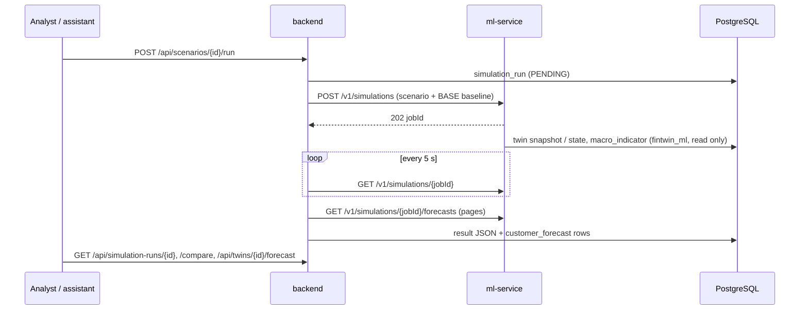

# Simulation engine — macro stress scenarios on the twins

The simulation engine (`ml-service/app/simulation/`) applies a macroeconomic scenario to the customer twins, projects
every customer's finances month by month with Monte Carlo shocks, and turns the projected twin features into
default and churn events with the active PD and churn models. The output is a stress-test style portfolio
result: default and churn distributions, expected and tail loss, segment impact, rating migration, the most
affected customers with reasons, and per-customer cash-flow bands. The backend (`com.fintwin.simulation`) stores
the scenarios and the results.

## Flow



- The ML service runs one job at a time in a background thread (memory budget). Jobs and results live in memory;
  the most recent 20 finished jobs are kept.
- The backend polls every 5 s (`fintwin.simulation.polling.interval`) through the shared `MlServiceClient`
  (RestClient timeouts, Resilience4j retry and circuit breaker). Once a job succeeds, the backend copies the
  result into `simulation.simulation_run.result` and the forecasts into `simulation.customer_forecast`.
- If the ML service restarts, its jobs are lost and the backend marks the affected runs `FAILED`. While the ML
  service is unreachable, starting a run returns 503 `ML_SERVICE_UNAVAILABLE`, but the run row is still stored
  as `FAILED`.

## Scenario model

`ScenarioParameters` is defined twice: as a Java record with Bean Validation (backend) and as a Pydantic model in
`app/simulation/scenario.py` (ML service). The Pydantic model forbids unknown fields. The same schema will be the
tool the scenario assistant fills from natural language in step 6, so every field has a description with its unit
and range.

| Field | Unit / range | Meaning |
|-------|--------------|---------|
| `horizonMonths` | 1–36 (12) | Simulation horizon |
| `usdTryChangePct` | % against the start, −50…200 | USD/TRY level change (30 = ×1.30) |
| `policyRateChangeBp` | bp, −3000…3000 | Policy rate change; card and deposit rates follow |
| `monthlyInflationPct` | % per month, −5…30, 1–36 values | CPI path from the first month; the last value repeats |
| `wageIndexationPct` | %, 0–150 (90) | Share of the inflation since the last raise that a raise passes on |
| `wageAdjustmentLagMonths` | months, 0–12 (6) | Months between raises, aligned to January: 6 = Jan + Jul, 12 = Jan, 0/1 = monthly |
| `segmentWageRules` | list | Per-segment override of the two wage fields |
| `shockProfile`, `shockRampMonths` | `IMMEDIATE` / `GRADUAL`, 1–36 | FX and rate changes at once, or linearly over the ramp |
| `monteCarloPaths`, `seed` | 10–2000 (200), int | Same scenario + seed ⇒ identical result |

Engine assumptions (`Assumptions`, optional per run, documented defaults):

| Assumption | Default | Rationale |
|------------|---------|-----------|
| `lgdUnsecured` | 0.70 | Cards and personal loans; Turkish unsecured retail recoveries are low |
| `lgdMortgage` | 0.25 | Collateralised |
| `cardCcf` | 0.30 | Share of the undrawn card limit drawn before default (EAD) |
| `discretionaryElasticity` | 0.6 | Real discretionary spending vs real income |
| `fxPassThrough` | 0.5 | Weight of USD/TRY (vs CPI) in electronics and travel prices |
| `revolvingShare` | 0.35 | Share of card balances that revolve and bear interest. Calibrated so that utilisation drifts as in the data (~+1 % relative per month). |
| `depositTaxRate` | 0.15 | Withholding tax on deposit interest |
| `systematicIncomeVolatility`, `systematicPersistence` | 0.02, 0.7 | Common income factor per path (AR(1)); creates loss correlation and tail risk |
| `incomeVolatilityScale` | 1.0 | Idiosyncratic monthly income noise = scale × the customer's income CV |
| `expenseVolatility` | 0.08 | Idiosyncratic monthly spending noise |
| `expenseReversion6m` | 0.34 | Share of a customer's deviation from the segment expense-to-income ratio that persists after 6 months. This is the 6-month regression slope measured on the twin snapshots. |
| `liquidityFloorMonths` | 0.5 | Cash kept before borrowed card debt is repaid |

### Preset scenarios (V9 seed data)

| Code | Scenario |
|------|----------|
| `BASE` | Inflation easing from 2.0 to 1.5 %/month; USD/TRY +15 % and policy rate −300 bp, both gradually over 12 months; raises every 6 months at 90 % of past inflation |
| `FX_SHOCK` | USD/TRY +30 % at once; inflation 4.5 → 2 %/month as pass-through fades; policy rate unchanged |
| `RATE_SHOCK` | Policy rate +500 bp at once; the base path otherwise |
| `STAGFLATION` | 4 %/month inflation; one raise a year at 60 % of past inflation; USD/TRY +40 % and policy rate +300 bp, gradually |
| `RECOVERY` | Disinflation to 1.2 %/month; USD/TRY +8 % and policy rate −800 bp, gradually; raises every 6 months at the full past inflation |

## Methodology

### Starting point

The starting point is either the twins' month-start snapshot (`startDate`, e.g. 2025-09-01) or the current twin
state, which starts in the month after the last processed event. Customers who defaulted or churned before the
start (`customer_event`) or whose accounts are all closed are excluded. Only the twin schema, `customer_event` and
`macro_indicator` are read, as role `fintwin_ml`; `ground_truth` is never read. The macro starting values are
USD/TRY and the policy rate of the month before the start. The realised CPI history determines the catch-up of
the first raise.

### Monthly projection (vectorised, arrays of shape paths × customers)

1. **Income.**
   - Formula: start income (median of the last 3 complete months) × wage index of the segment rule × common
     factor × idiosyncratic lognormal noise.
   - A raise in a raise month compensates `wageIndexationPct` × the inflation since the previous raise. Real
     income therefore erodes between raises.
2. **Spending** (per category, from the 90-day category mix).
   - Essentials (groceries, bills, rent, health, transport, fuel, education, cash) rise with CPI.
   - Discretionary categories (restaurants, entertainment, travel, clothing, electronics, e-commerce) rise with
     prices and also follow real income with elasticity 0.6.
   - Electronics and travel prices are a blend of CPI and USD/TRY (`fxPassThrough`).
   - Other outflows (transfers out, fees) rise with CPI.
   - All outflows revert towards the segment's expense-to-income ratio. 90-day averages contain transient items
     (yearly payments, large purchases): in the data the 6-month regression slope is 0.34, and customers with a
     measured deficit still saved about half a monthly income over 6 months.
3. **Debt service.**
   - Loan installments stay fixed in nominal terms and loans amortise and mature on schedule.
   - The card rate follows the policy rate inside the regulatory band, `clip(policy/12 × 0.95 + 0.25 %, 1.75 %,
     5 %)` (the generator's rule). Revolving interest is capitalised on the card.
   - Card limits are indexed to CPI while the customer is in good standing.
4. **Savings and FX.**
   - Time deposits earn (policy − 4 pp) net of withholding.
   - USD balances are revalued at the scenario rate.
5. **Negative cash flow.**
   - A shortfall is covered by the TRY buffer first, then by selling USD at the scenario rate, then by drawing
     the card limit.
   - A remaining shortfall with obligations due is a missed payment: the late payment count goes up, the days
     since the last late payment reset, and the card is blocked.
   - Surplus cash above half a month of outflows repays card debt borrowed during the simulation.
6. **Features.** The twin features are recomputed from the projected state (see the table below) and anchored on
   the observed start values: the model sees `observed + (projected − recomputed start)`. Month 1 is therefore
   exactly the twin, and only the projected change reaches the models.

| Projected (change over time) | Held constant (and why) |
|---|---|
| utilisation, debt service / income, card and total debt / income, expense / income, liquidity buffer, spending trend, spending shares, late payment count, days since last late payment, active loans | income CV and salary-day deviation: these describe the income process, which the scenario does not change, and they are unstable in the twin's warm-up. Deposit share: the savings split is a habit. Card / USD flags: product holding. Segment. |

### From model scores to monthly events

The PD and churn models are point-in-time 6-month models. Re-scoring a mechanical projection with them in
absolute terms double counts two things the PD at the start already prices: the customer's own uncertainty, and
the deterioration that is typical within six months (future missed payments included). Without a correction the
back-test overshot the observed default rate by 75 % (simulated 3.6 % against 2.1 % observed). The engine
therefore applies the model as a scenario multiplier, as stress tests do with point-in-time PDs:

```
PD_t   = sigmoid( logit PD_0 + logit PD(features_t | scenario) − logit PD(features_t | reference) )
h_t    = 1 − (1 − PD_t)^(1/6)              (monthly hazard with the same 6-month cumulative probability)
```

- **The reference path** is a neutral continuation: inflation at its trailing 12-month average, incomes raised in
  January and July by the full past inflation, USD/TRY moving with prices, and an unchanged policy rate.
- **Same shocks, no common factor.** The reference is projected with the same idiosyncratic shocks as the scenario
  and without the common factor. Mechanics shared by both projections (expense reversion, ageing of
  delinquencies, a structural deficit, individual shocks) cancel out. What reaches the hazard is the scenario's
  macro path and the systematic factor.
- **Neutral start.** Under the reference path, the expected 6-month default rate equals the mean start PD; the
  `test_neutral_scenario_reproduces_the_start_pd` test checks this.
- **Sampling.** Each month, a default (credit customers only) and then a churn is sampled from the monthly
  hazards with per-customer uniforms. Events are terminal, so a customer who defaulted is not counted again.
  Loss = LGD × EAD at the month of default, where EAD = card debt + CCF × undrawn limit + loan principal.

### Randomness and determinism

- Every customer has its own seed sequence `(seed, customer id)`. The common factor has `(seed, 0)`.
- The results are therefore identical regardless of chunk size or thread count.
- The scenario, the baseline and the reference use the same draws (common random numbers), so their difference
  has very little Monte Carlo noise.

### Memory and chunking

Customers are processed in chunks with all paths at once (`SIM_CHUNK_ROWS`, default 100k rows = paths ×
customers per chunk):

- Per-customer bands (P10/P50/P90) are exact.
- Per-path portfolio sums are accumulated across chunks.
- Arrays are float64 for the state and float32 for the model matrix.
- LightGBM prediction uses `SIM_THREADS` threads (default half the cores, at most 8). It accounts for about 85 %
  of the runtime, and the PD is only computed for customers with credit exposure.

## Outputs

- **Portfolio**:
  - Monthly default rate (credit customers), churn rate and cumulative rates: mean, P5, P50, P95 over the paths.
  - Mean PD and mean features per month.
  - Expected loss (mean of the path losses) and the loss distribution (P5…P99); unexpected loss = P99 − EL.
  - EL as a % of the starting EAD.
- **Segments**: default and churn distributions, EL and P99 per segment. With a baseline, the per-path delta for
  the portfolio and each segment.
- **Migration**: start grade (master scale on the start PD) to the end state at the horizon: grade 1–10,
  `DEFAULT` or `CHURN`. Counts and row rates over credit customers × paths.
- **Top customers**: the largest increase from the start PD to the PD at the horizon. Reasons are the SHAP
  contributions that grow between the central (shock-free) reference and scenario paths, shown with start,
  neutral and scenario values.
- **Forecasts**: per customer and month, P10/P50/P90 of the liquid balance (TRY + USD at the scenario rate) and of
  the liquidity buffer in months, plus the cumulative default probability.

## Back-test

**Setup.** Each start month is simulated from its month-start snapshot over 6 months with 200 paths and seed 42,
using the realised macro path (CPI, USD/TRY and the policy rate from `macro_indicator`) and the public wage-setting
rules of the period:

| Segment | Wage rule |
|---|---|
| Minimum wage | once a year at 100 % |
| Pensions | every 6 months at 100 % |
| White collar | once a year at 75 % |
| Self-employed | monthly at 85 % |
| Students | once a year at 75 % |

The comparison is with `customer_event` for the same customers. *Static* is the mean 6-month PD (churn
probability) at the start, without projection. Report: `artifacts/reports/backtest-20261022-111112.json`; log:
`logs/backtest-20261022-111112.log`.

| Start | Customers (credit) | Default simulated [P5–P95] | Static | Observed (n) | Churn simulated | Static | Observed (n) |
|---|---|---|---|---|---|---|---|
| 2025-09 | 4,347 (3,219) | **2.18 %** [1.86–2.55] | 2.21 % | **2.08 %** (67) | **2.98 %** | 2.94 % | **2.85 %** (124) |
| 2025-12 | 4,365 (3,206) | **1.87 %** [1.56–2.19] | 2.00 % | **1.97 %** (63) | **3.09 %** | 2.99 % | **3.16 %** (138) |
| 2026-03 | 4,371 (3,187) | **1.68 %** [1.41–2.01] | 1.70 % | **1.63 %** (52) | **3.02 %** | 2.98 % | **2.81 %** (123) |
| 2026-04 | 4,365 (3,178) | **1.72 %** [1.38–2.01] | 1.62 % | **1.32 %** (42) | **3.56 %** | 3.52 % | **2.79 %** (122) |

- **2025-09.** This start lies in the PD model's calibration (validation) period. The other three starts are in
  its test period (out of sample).
- **Inside the band.** The observed default rate is inside the simulated P5–P95 band for 2025-09, 2025-12 and
  2026-03.
- **2026-04 overestimates.** The window ending at the data end is overestimated by both the simulation and the
  static PD (1.32 % observed). The deviation therefore comes from the model's calibration in that window, not from
  the projection; churn shows the same pattern (3.56 % vs 2.79 %).
- **Segments.** The ranking is reproduced. MIN_WAGE is underestimated: 3.2 % vs 4.0 % and 3.3 % vs 4.8 % for the
  first two starts. SELF_EMPLOYED is overestimated: 3.6 % vs 2.4 % and 3.4 % vs 1.7 %. RETIREE and WHITE_COLLAR
  have only 0–4 events per window. Segment churn is overestimated for RETIREE and WHITE_COLLAR and underestimated
  for STUDENT. The PD and churn models show the same segment patterns (docs/models.md).

**Projected features against the actual snapshots 6 months later** (portfolio means of the customers still
active):

| Start | Liquidity buffer (months) | Utilisation | Expense / income | Debt service / income |
|---|---|---|---|---|
| 2025-09 | 4.01 vs 4.19 | 0.436 vs 0.448 | 0.878 vs 0.886 | 0.229 vs 0.223 |
| 2025-12 | 4.60 vs 4.83 | 0.441 vs 0.451 | 0.869 vs 0.867 | 0.217 vs 0.213 |
| 2026-03 | 4.77 vs 5.06 | 0.457 vs 0.480 | 0.937 vs 0.913 | 0.236 vs 0.224 |

The projection slightly under-predicts savings growth and utilisation drift. Both stay within 5 % of the actual
means.

**Calibration history.** The first version re-scored the projected features in absolute terms and simulated
3.62 % for 2025-09 (observed 2.08 %). Two changes fixed this: expense mean reversion brought it to 2.56 %, and the
reference-anchored log-odds hazards brought it to 2.18 %.

## Preset scenarios (current state, start 2026-10, 12 months, 200 paths)

The portfolio has 4,383 customers, 3,140 of them with credit exposure; the mean start PD is 1.87 %. Each scenario
is run against BASE with common random numbers. Report:
`ml-service/artifacts/reports/presets-20261022-082550.json`; log: `logs/presets-20261022-111112.log`.

| Scenario | Default rate 12 m [P5–P95] | Churn | Expected loss | EL / EAD | P99 loss | Δ default vs BASE | Δ EL vs BASE | Run time |
|---|---|---|---|---|---|---|---|---|
| BASE | 3.23 % [2.74–3.82] | 5.51 % | 5.71 M TRY | 1.82 % | 7.46 M TRY | — | — | 122 s |
| FX_SHOCK | 4.21 % [3.57–4.94] | 5.43 % | 8.01 M TRY | 2.55 % | 10.34 M TRY | +0.98 pp | +2.30 M TRY | 186 s |
| RATE_SHOCK | 3.38 % [2.86–3.98] | 5.50 % | 6.02 M TRY | 1.91 % | 7.96 M TRY | +0.15 pp | +0.31 M TRY | 188 s |
| STAGFLATION | 4.72 % [4.01–5.45] | 5.38 % | 9.75 M TRY | 3.10 % | 12.16 M TRY | +1.49 pp | +4.04 M TRY | 187 s |
| RECOVERY | 2.92 % [2.52–3.35] | 5.61 % | 5.02 M TRY | 1.60 % | 6.47 M TRY | −0.31 pp | −0.69 M TRY | 181 s |

The monthly default rate in STAGFLATION rises from 0.39 % in month 1 to 0.81 % in month 12. In BASE it falls to
0.23 % as the start delinquencies run off.

**Default rate by segment** (12 months, mean; Δ vs BASE in pp):

| Segment | BASE | FX_SHOCK | RATE_SHOCK | STAGFLATION | RECOVERY |
|---|---|---|---|---|---|
| MIN_WAGE | 4.84 % | 6.50 % (+1.67) | 5.08 % (+0.24) | 7.35 % (+2.52) | 4.27 % (−0.56) |
| RETIREE | 2.13 % | 3.16 % (+1.03) | 2.30 % (+0.17) | 3.68 % (+1.55) | 1.86 % (−0.27) |
| SELF_EMPLOYED | 4.85 % | 6.18 % (+1.33) | 5.02 % (+0.16) | 7.00 % (+2.14) | 4.42 % (−0.43) |
| STUDENT | 15.18 % | 17.58 % (+2.39) | 15.62 % (+0.43) | 18.53 % (+3.35) | 14.29 % (−0.89) |
| WHITE_COLLAR | 0.59 % | 0.86 % (+0.27) | 0.63 % (+0.04) | 1.00 % (+0.41) | 0.52 % (−0.07) |

**Reading the results.**
- **Segments.** STUDENT and MIN_WAGE are hit hardest in absolute terms. RETIREE has the largest relative increase
  (+48 % under FX_SHOCK, +73 % under STAGFLATION), because pensions catch up only every six months. WHITE_COLLAR
  has large buffers.
- **Rate shock.** It is mild: card rates are capped at 5 % a month and deposits gain interest, which offsets part
  of the higher card cost. Only revolvers are hit.
- **Churn.** It hardly changes; see the limitations.

**End-to-end check through the backend** (run 2, user-defined `SEVERE_FX`: USD/TRY +50 % at once, inflation
6 → 3 %, raises at 70 %; 100 paths, against BASE):

| Metric | Value |
|---|---|
| Default rate | 5.84 % [5.12–6.69] |
| Δ vs BASE | +2.66 pp [2.16–3.22] |
| Expected loss | 11.90 M TRY (3.78 % of EAD) |
| P99 loss | 15.22 M TRY |
| ML run time | 93 s |
| Peak RSS | 588 MB |

All 4,383 forecasts were stored.

Sample cash-flow band, customer 6 (RETIREE, PD 1.40 %) under `SEVERE_FX`:

| Month | Liquid balance P10 / P50 / P90 (TRY) | Buffer P10 / P50 / P90 (months) | Cum. default probability |
|---|---|---|---|
| start | 217,006 | 2.13 | — |
| 2026-10 | 270,160 / 274,771 / 280,116 | 1.84 / 1.99 / 2.16 | 0 % |
| 2027-01 | 251,335 / 264,378 / 276,144 | 1.28 / 1.61 / 1.90 | 1 % |
| 2027-04 | 236,916 / 258,762 / 272,717 | 0.98 / 1.37 / 1.74 | 5 % |
| 2027-09 | 215,644 / 243,952 / 269,254 | 0.50 / 1.03 / 1.49 | 7 % |

- The balance jumps in the first month because the customer's USD savings are revalued.
- After that, erosion between raises and higher prices drain the buffer.
- The PD at the horizon is 5.3 %, against 1.40 % at the start.

**Runtime and memory.**
- One preset run takes 3–3.5 minutes: 4,383 customers × 200 paths × 12 months × 3 projections (scenario,
  baseline, reference).
- Peak RSS is about 0.5 GB, including the loaded models.
- A 6-month back-test start (2 projections) takes about 60 s.
- About 85 % of the time is LightGBM prediction (4 threads).

## Limitations

- **Churn barely reacts to macro stress.** Central-path decomposition for the presets (current state, 12 months;
  churn log-odds shift against the reference):

  | Scenario | Churn log-odds shift | PD log-odds shift |
  |---|---|---|
  | BASE | −0.004 | +0.03 |
  | FX_SHOCK | −0.002 | +0.32 |
  | RATE_SHOCK | +0.001 | +0.07 |
  | STAGFLATION | −0.126 | +1.31 |
  | RECOVERY | +0.016 | −0.18 |

  There are two reasons:
  1. **The main driver is not macro-sensitive.** The churn model's strongest driver is the number of active loans
     (mean |SHAP| 0.69). The projection keeps loans on their fixed schedule and opens no new ones, so this feature
     does not react to the macro path (portfolio mean 0.09 in both paths).
  2. **The features that do move push churn the other way.** The features carrying the stress are expense-to-income
     and total debt-to-income (in STAGFLATION 0.93 → 1.12 and 0.73 → 0.97). They have *negative* partial effects in
     the churn model: indebted customers are tied to the bank, and the generator only lets customers without loans
     or arrears leave. The higher churn implied by the lower buffer and higher utilisation is therefore offset.

  The engine propagates what the churn model has learned; the gap is in the model's macro sensitivity, not in the
  projection. Possible improvements:
  - a churn model with change features (real income change, buffer change over 3–6 months) that react to the
    scenario;
  - modelling new lending and refinancing in the projection;
  - an explicit, documented macro overlay for churn (a satellite model of segment churn on real income), validated
    against the back-test.
- **The back-test validates mostly the calibration.** The realised macro path of 2025-09 … 2026-09 was close to the
  neutral reference, so it tests the calibration and the non-macro mechanics rather than large shocks. Shock
  responses are only covered by the logic tests (monotonicity, zero shock, USD holders).
- **No feedback loops.** Customers do not take new loans, do not change products and do not respond to collections.
  Wages follow one rule per segment. There is no explicit unemployment series; job-loss risk enters only through
  the income noise and the systematic factor.
- **Inherited model behaviour.** The PD and churn models are tree ensembles without monotonic constraints. Small
  non-monotonic responses to individual features are possible; the portfolio-level monotonicity tests pass.
- **Simplified balance-sheet mechanics.** LGD, CCF and the revolving share are assumptions. Card limits are indexed
  to CPI. Seasonality (bayram, holidays) is not projected.
- **Data ends at 2026-10.** The 2026-04 back-test covers the last complete 6-month window. No snapshot exists
  6 months after it, so the feature comparison is skipped for that start. In this window both the simulation and
  the static PD overestimate defaults (1.72 % / 1.62 % against 1.32 %) and churn: the models' calibration drifts at
  the end of the data, and recalibration would need more months.
