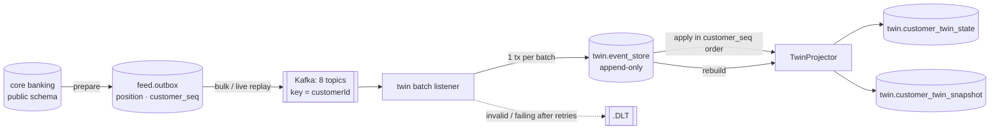

# Customer digital twin

Every customer has a **behavioural twin**: a projection of the customer's financial life that is built only from
events published by the core banking system over Kafka. The twin never reads the core banking tables (`public`
schema) and never touches the generator's `ground_truth` schema; its data lives in the `twin` schema. Its features
are the inputs of the behaviour models (PD, churn, cash-flow forecasting).



## Components

| Component | Package | Role |
|---|---|---|
| Event contracts | `com.fintwin.events` | `CoreBankingEvent` envelope, V1 records, topics, `EventCodec` (JSON) |
| Core banking feed | `com.fintwin.feed` | outbox, replay producer (bulk/live), admin API, consistency check |
| Twin | `com.fintwin.twin` | consumer, event store, projection, snapshots, as-of, rebuild, API |

The feed belongs to the core banking side and may read `public`. The twin may only use `events` and the `twin`
schema; `TwinIsolationTests` enforces this (ArchUnit package rule + scan of the twin's SQL for non-`twin` tables
and `ground_truth`).

## Topics and event schemas

All topics have 6 partitions and are keyed by `customerId`; each has a `<topic>.DLT` dead letter topic. Payloads are
JSON. Every event carries the envelope `eventId` (UUID), `eventType`, `schemaVersion`, `occurredAt` (UTC instant),
`customerId` and `customerSequence`.

| Topic | Event | Fields (besides the envelope) | Why it exists |
|---|---|---|---|
| `fintwin.transactions.recorded.v1` | `TransactionRecorded` | transactionId, accountId, amount, currency, direction, channel, installmentCount, rawDescription, merchantId, merchantName, merchantCategory, counterpartAccountId | every posted movement |
| `fintwin.card-statements.issued.v1` | `CardStatementIssued` | statementId, accountId, statementDate, dueDate, statementBalance, minimumPayment | minimum payment = monthly obligation |
| `fintwin.loan-installments.settled.v1` | `LoanInstallmentSettled` | loanId, installmentNo, dueDate, paidAt, principal/interest/total, remainingPrincipal, daysPastDue | loan amortisation |
| `fintwin.customers.registered.v1` | `CustomerRegistered` | customerSince, segment, age, city, occupationGroup | the twin's birth; profile |
| `fintwin.accounts.opened.v1` | `AccountOpened` | accountId, accountType, currency, openedAt, openingBalance, creditLimit, statementDay, dueDay, interestRate | balances cannot be projected without the opening position |
| `fintwin.accounts.closed.v1` | `AccountClosed` | accountId, closedAt | attrition and write-offs are visible as closures |
| `fintwin.loans.disbursed.v1` | `LoanDisbursed` | loanId, loanType, principal, monthlyInterestRate, termMonths, disbursedAt, installmentAmount, paidInstallments, outstandingPrincipal | debt and installment burden; migrated loans carry their position |
| `fintwin.payments.past-due.v1` | `PaymentPastDue` | product (CARD_STATEMENT / LOAN_INSTALLMENT), referenceId, accountId / loanId, dueDate, amountDue | delinquency is a fact the bank notices at due date + 1 |

The five extra topics are needed because the three requested ones cannot rebuild a customer on their own: without
`AccountOpened` there is no opening balance, without `LoanDisbursed` no debt or installment amount, without
`PaymentPastDue` no delinquency count. `customer_event` (DEFAULT / CHURN labels) is **not** published: those are
model targets and must not leak into features.

Existing customers, accounts and loans enter the feed at its start (the first day of the first transaction month)
as "migration" events carrying their position at that moment; facts that happen later are published when they
happen.

**Versioning.** Consumers ignore unknown fields, so adding an optional field is compatible. Removing a field or
changing its meaning requires a `...V2` record on a new `.v2` topic (`schemaVersion` is part of every payload and is
stored in the event store).

## Outbox and replay

The feed is modelled as a **transactional outbox**: `prepare` builds `feed.outbox` from the core banking tables in
one set-based SQL statement. Each row is a source fact (kind + source id) with

- `position` — global event-time order (ties broken by kind priority, customer, source id);
- `customer_seq` — gap-free 1..n per customer across **all** topics.

Why an outbox instead of streaming the tables directly:

1. **Ordering is decided once, in the database.** The per-customer sequence is what lets the twin restore order
   across topics (see below); computing it at publish time would need a full sort per run.
2. **Restartable and resumable.** The replay cursor (`feed.replay_state`) is the outbox position of the last
   published page, persisted after each page. Stop, crash and resume continue where they left off; live mode can
   start where a bulk run stopped.
3. **Idempotent republishing.** Event ids are name-based UUIDs of `(dataset epoch, kind, source id)`. Republishing
   any range produces the same ids, which the twin deduplicates. The epoch is a fingerprint of the data set, so a
   regenerated data set never collides with old events.
4. **Cheap paging.** Publishing reads outbox pages by primary key and loads the source rows per kind with one query
   each — no wide joins over 5.5 M transactions.

Modes:

- **Bulk** (`POST /api/admin/replay/bulk?until=`): publishes pages of 10,000 events as fast as possible up to the end
  of `until` (default: everything).
- **Live** (`POST /api/admin/replay/live?secondsPerDay=5&from=`): a `ReplayClock` maps real time to simulated time
  (one simulated day per `secondsPerDay` real seconds); every 200 ms it publishes the events with
  `occurredAt < simulatedNow`. `POST /speed` changes the rate without a jump in simulated time; `from` fast-forwards.
- `POST /stop`, `POST /reset` (rewind), `POST /prepare`, `GET /status` (mode, simulated time, position / total,
  published events, events/s).

The producer is idempotent (`acks=all`, `enable.idempotence`), compresses with lz4 and batches (256 KB, 10 ms linger).

## Ordering, idempotency and the event store

Kafka guarantees order only within a partition of one topic; a customer's events are spread over eight topics, so
a statement can arrive before the transactions that precede it. The twin therefore applies events **strictly in
`customerSequence` order**, whatever their arrival order:

1. A batch (up to 20,000 records from all topics) is decoded. If a record is invalid, the valid prefix is processed
   and the error handler is told the failing index (`BatchListenerFailedException`).
2. In **one database transaction**:
   - events are appended to `twin.event_store` with `INSERT … ON CONFLICT (event_id) DO NOTHING` — the
     idempotency check and the state update share the transaction, so a redelivered event can never be applied
     twice;
   - for every customer in the batch, the stored but not yet applied events (`customer_seq > last_seq`) are read in
     sequence order and the contiguous run is applied; an event after a gap waits in the store until the missing
     one arrives (the event store doubles as re-sequencing buffer);
   - month-start snapshots are written when an event crosses into a new month;
   - the projection is saved with `UPDATE … WHERE version = ?` (**optimistic locking**; zero rows ⇒
     `OptimisticLockingFailureException` ⇒ rollback and retry).
3. Offsets are committed after the transaction (`AckMode.BATCH`).

`twin.event_store` is append-only: a trigger rejects `UPDATE` and `DELETE`. It also stores topic, partition and
offset of each event for traceability.

**Errors.** `DefaultErrorHandler` retries with exponential back-off (200 ms × 2, 3 attempts) and then publishes the
record to `<topic>.DLT` via `DeadLetterPublishingRecoverer`. Payloads that cannot be parsed
(`InvalidEventException`) are not retried. A sequence conflict (same customer and sequence, different event id —
e.g. a regenerated data set replayed into an old twin) fails loudly instead of being silently merged; reset the
twin first (`POST /api/admin/twins/reset`).

## Projection and snapshots

`TwinProjector` (pure Java, no Spring) folds events into a `TwinState`: profile, account positions, loan positions,
last statement, daily spending buckets per category (91 days), daily outflows (91 days), monthly income and the day
of the largest income credit (13 months), late payment record, and pending loan movements used to classify
matching transactions. Money is held in minor units (`long`). The state is serialised to JSONB with sorted keys,
so equal states have equal JSON.

Features are computed from the state by `TwinFeatureCalculator` **at an evaluation instant** — the last event for
the stored projection, the month start for snapshots, the cut-off for as-of queries — never at wall-clock time. This
makes live projection, rebuild and as-of replay produce identical results.

**Snapshots** (`twin.customer_twin_snapshot`): before applying the first event of a new month, the state is stored
with features evaluated at that month start (one row per month boundary crossed).

**As-of** (`GET /api/twins/{id}?asOf=2025-06-01`): cut-off = start of the next day in bank time
(Europe/Istanbul). The latest snapshot with `as_of ≤ cut-off` is loaded, the stored events after its sequence with
`occurredAt < cut-off` are replayed, and the features are evaluated at the cut-off.

**Rebuild** (`POST /api/admin/twins/rebuild?mode=VERIFY|REPLACE`): replays the whole event store customer by
customer with the same projector. `VERIFY` compares the result with the stored projection and snapshots and reports
differences without writing; `REPLACE` pauses the consumer, discards projection and snapshots (never the event
store) and writes the rebuilt ones.

## Feature dictionary

Windows are bank-local days ending with the evaluation day (30 days = the evaluation day and the 29 before it).
"Complete months" are calendar months before the evaluation month in which the customer was observed from the
first day; months without income count as zero. Money is in TRY unless noted. `null` means "not defined" (no card,
no income observed, …) and must be treated as missing, not as zero.

### Balances and debt

| Feature | Definition | Computation | Why it matters |
|---|---|---|---|
| `checkingBalance` | Funds in TRY demand accounts | opening balance + credits − debits of all TRY `CHECKING` accounts | immediate liquidity |
| `depositBalance` | Funds in time deposits | same for `TIME_DEPOSIT` (interest arrives as `SYSTEM` credits) | savings buffer; broken under stress |
| `usdBalance` | Funds in USD accounts, in USD | same for USD `CHECKING`; not converted (no FX rate reaches the twin) | dollarisation / hedging behaviour |
| `cardDebt` | Outstanding credit card debt | opening debt + card debits (purchases incl. full installment amounts, cash advances, interest) − card credits (payments) | revolving credit exposure |
| `cardLimit` | Credit limit of open cards | sum of `creditLimit` of open card accounts | capacity; denominator of utilisation |
| `utilizationRate` | Share of the limit in use | `cardDebt / cardLimit`; `null` without an open card | one of the strongest early-warning signals for default |
| `loanOutstanding` | Remaining principal of active loans | from `LoanDisbursed.outstandingPrincipal`, then `remainingPrincipal` of each settled installment | amortising debt |
| `totalDebt` | All debt | `cardDebt + loanOutstanding` | leverage |
| `activeLoans` | Number of active loans | loans with installments remaining | credit hunger, stacking |

### Spending

| Feature | Definition | Computation | Why it matters |
|---|---|---|---|
| `spend30d`, `spend90d` | Consumer spending in the last 30 / 90 days | sum of spending transactions in the window | consumption level |
| `spendByCategory30d`, `spendByCategory90d` | Same per category | category = merchant category (MCC group) for merchant payments, `CASH_WITHDRAWAL` for ATM, `RENT` for transfers whose text contains `KIRA` | spending mix; essential vs discretionary; input for categorisation and cash-flow models |
| `spendTrend` | Recent spending against the 90-day pace | `spend30d / (spend90d / 3) − 1`; `null` without 90-day spending | spending cuts (stress, pre-churn) or spikes (holidays, distress borrowing) |

Spending excludes own-account transfers (linked by `counterpartAccountId`), card payments, loan installments,
interest and person-to-person transfers. The rules live in `TransactionClassifier` and are a deliberate placeholder
for the NLP categorisation model; they never see the generator's true labels.

### Income

| Feature | Definition | Computation | Why it matters |
|---|---|---|---|
| `incomeEstimate` | Typical monthly income | median of the income of the last 3 complete months; income = external TRY credits to deposit accounts, excluding own-account transfers, loan proceeds (matched to `LoanDisbursed`) and interest | denominator of affordability ratios; real-income erosion |
| `incomeMonthsObserved` | Complete months available (≤ 6) | count | confidence of the income features |
| `incomeCv` | Income volatility | standard deviation / mean of the last up to 6 complete months (≥ 3 required) | irregular income (self-employed, job loss) raises default risk |
| `salaryDayDeviation` | Regularity of the pay day, in days | RMS distance between the day of the month's largest income credit and its most frequent value, over the last up to 6 complete months (≥ 3), wrapping around month ends (day 30 vs day 1 = 1 day) | a stable salary day indicates payroll employment; drift or gaps signal job change or loss |

### Obligations and affordability

| Feature | Definition | Computation | Why it matters |
|---|---|---|---|
| `monthlyObligations` | Mandatory monthly payments | sum of installments of active loans + minimum payment of the last card statement if issued within 45 days | fixed debt service the customer cannot avoid |
| `debtToIncome` | Debt service ratio | `monthlyObligations / incomeEstimate`; `null` without positive income | the classic affordability measure; drives stress in the causal model |

### Delinquency

| Feature | Definition | Computation | Why it matters |
|---|---|---|---|
| `latePaymentCount` | Missed due dates so far | number of `PaymentPastDue` events | past delinquency predicts future default |
| `daysSinceLastLatePayment` | Recency of the last miss | evaluation day − day of the last `PaymentPastDue`; `null` if never late | recent misses weigh far more than old ones |

### Liquidity

| Feature | Definition | Computation | Why it matters |
|---|---|---|---|
| `avgMonthlyExpense` | Average monthly external outflow | all external TRY outflows of the last 90 days (spending, rent, bills, installments, interest, transfers out) / 3 | burn rate |
| `liquidityBufferMonths` | How long liquid TRY funds last | `(checkingBalance + depositBalance) / avgMonthlyExpense`; `null` without outflows | shock absorption: a thin buffer turns an income shock into missed payments |

## API

| Endpoint | Returns |
|---|---|
| `GET /api/twins/{customerId}` | current twin: profile, accounts, loans, features (as of the last event) |
| `GET /api/twins/{customerId}?asOf=2025-06-01` | the twin at the end of that day (snapshot + replay) |
| `GET /api/twins/{customerId}/events?from=&to=` | events the twin processed (inclusive dates, max 5,000) |
| `GET /api/twins/{customerId}/history?feature=utilizationRate` | monthly series from snapshots plus the current value; any scalar feature above |
| `POST /api/admin/twins/rebuild?mode=VERIFY\|REPLACE` | rebuild statistics and mismatch counts |
| `POST /api/admin/twins/reset`, `GET /api/admin/twins/stats` | wipe (after regenerating data) / counts |
| `/api/admin/replay/*` | feed operation (see above); `GET /api/admin/replay/consistency?sample=` compares twin and core balances |

Admin endpoints are open while `SecurityConfig` is permit-all; they must be restricted when role-based security
lands.

## Observability

Micrometer metrics, exposed at `/actuator/metrics` and `/actuator/prometheus`:

| Metric | Meaning |
|---|---|
| `twin.events.received` / `twin.events.processed` / `twin.events.duplicates` | records received, events applied, redeliveries ignored |
| `twin.events.dlt` | records sent to a dead letter topic |
| `twin.batch.duration` | time per consumer batch |
| `twin.consumer.lag` | publication-to-processing delay (record timestamp → processed) |
| `kafka.consumer.fetch.manager.records.lag.max` | Kafka consumer lag in records (Kafka client metric) |
| `twin.snapshots.written` | month-start snapshots written |
| `feed.events.published`, `feed.replay.position`, `feed.replay.simulated.time` | replay progress |

## Operations

After regenerating core banking data:

```bash
make generate                                         # also invalidates the outbox
curl -X POST localhost:8080/api/admin/twins/reset     # twin built from the old data set
curl -X POST localhost:8080/api/admin/replay/prepare
curl -X POST localhost:8080/api/admin/replay/bulk     # or /live?secondsPerDay=5
curl localhost:8080/api/admin/replay/status
```

`scripts/measure-twin.sh` performs a clean, timed end-to-end run (resets twin, cursor, consumer group and topics;
writes to `logs/`).

<!-- results:start -->
## Measured results (default data set: 5,000 customers × 24 months)

Laptop, PostgreSQL 16 and Kafka in Docker Desktop, backend with 6 consumer threads. Logs:
`logs/measure-20261022-083120.log`, `logs/verify-20261022-083849.log` (local, gitignored).

**Clean bulk replay** (`scripts/measure-twin.sh`: twin tables, replay cursor, consumer group and all `fintwin.*`
topics reset first; publishing and consuming run concurrently):

| Metric | Value |
|---|---|
| Outbox events | 5,688,485 (prepare: ~23 s) |
| Publishing finished | 262 s — 21,700 events/s (alone, without a concurrent consumer: ~36,000 events/s) |
| Twin complete (all events stored **and** applied) | 397 s — **14,300 events/s end to end** |
| Twins / snapshots | 5,000 / 99,693 |
| Dead-lettered records | 0 |

Throughput depends mainly on how often each customer's projection is rewritten: batches of up to 20,000 records
and 91 days of retained buckets keep that low. With 5,000-record batches and the default 128 MB `shared_buffers`
the consumer degraded to ~4,000 events/s; infra/docker-compose.yml therefore tunes Postgres for bulk loads.

**Rebuild** (`scripts/verify-twin.sh`):

| Mode | Events | Duration | Mismatches |
|---|---|---|---|
| VERIFY | 5,688,485 | 120 s (47,000 events/s) | 0 states, 0 snapshot series |
| REPLACE | 5,688,485 | 119 s (48,000 events/s) | checksums of all 5,000 projections and 99,693 snapshots identical before and after |

**Consistency with core banking**:

- all 11,247 accounts: twin balance = `account.balance` (0 mismatches);
- 20 randomly chosen customers (41 accounts, TRY and USD, checking, deposit and card): all equal;
- as-of: 5 random customers × 3 dates (2024-12-15, 2025-06-01, 2026-01-31) — every account balance from
  `GET /api/twins/{id}?asOf=` equals the balance recomputed from core banking as opening balance plus movements
  before the cut-off.
<!-- results:end -->
